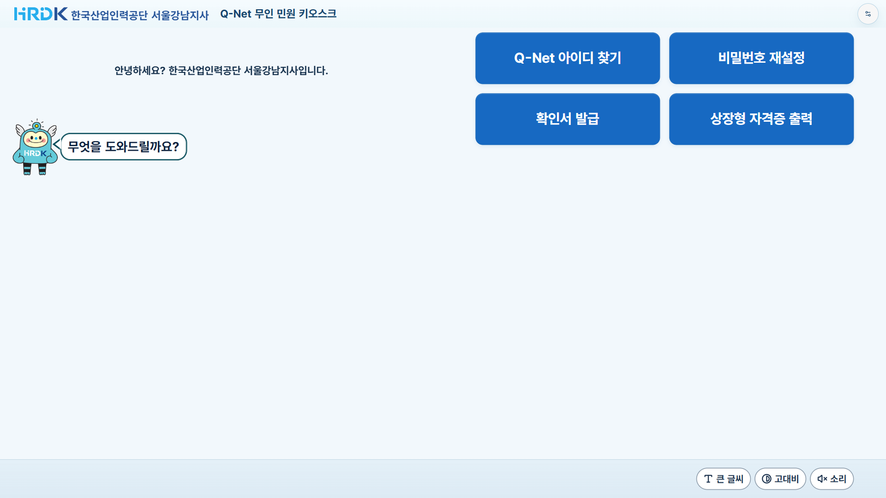
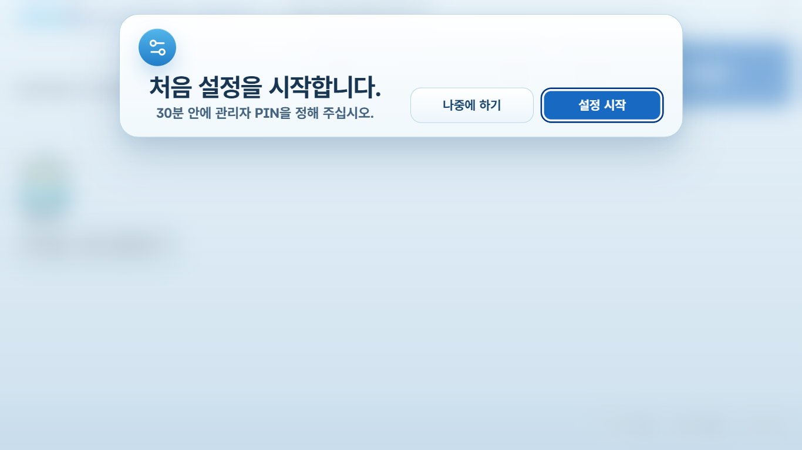
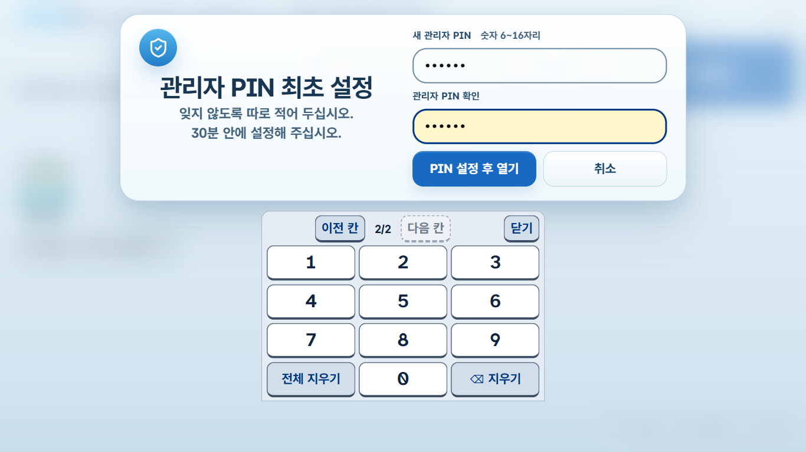
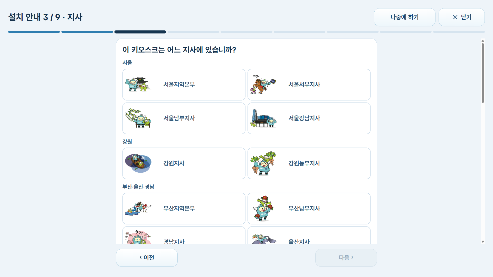
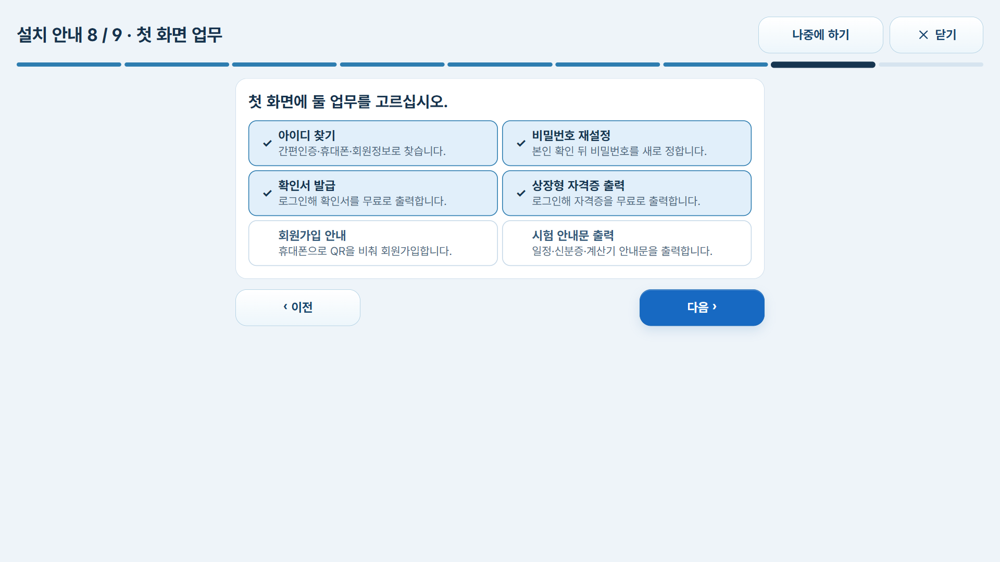
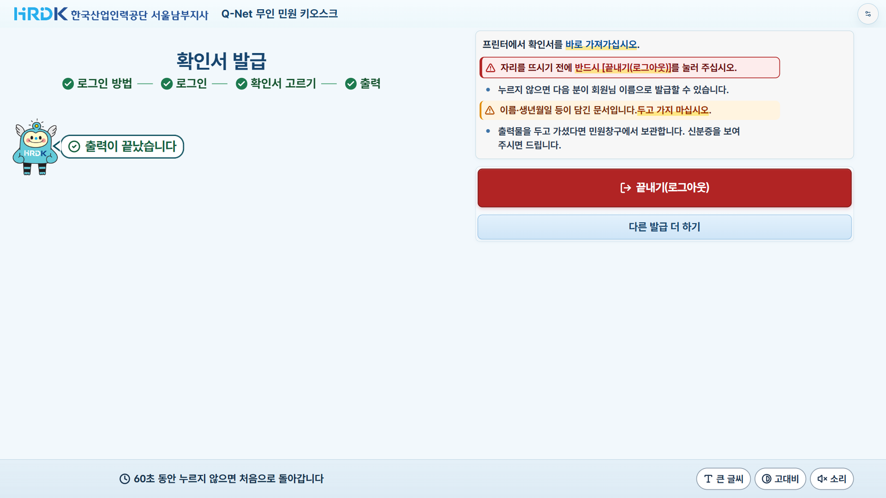
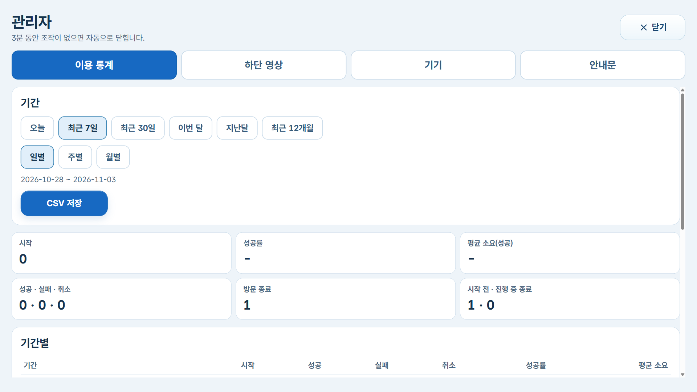
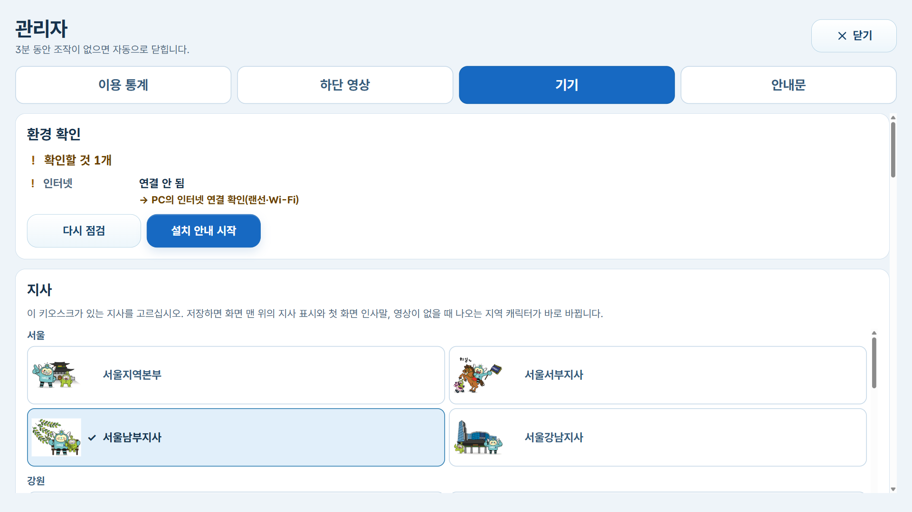

# Q-Net 무인 민원 키오스크 설치·운영 안내서

한국산업인력공단 'Q-Net 무인 민원 키오스크' 앱의 설치 파일을 내려받는 곳입니다.
이 앱을 처음 쓰는 분도 이 안내서만 보고 설치하고 운영할 수 있게 썼습니다. 코딩 지식은 필요 없습니다.

**설치 파일 받기: [최신 판 내려받기 페이지](https://github.com/SungmanYou/hrdk-qnet_kiosk_electron-publisher/releases/latest)**

> 그림은 가짜 값으로 돌린 시험 화면입니다. 실제 화면과 지사 이름·그림·글씨 크기가 다를 수 있습니다.

## 차례

1. [이 앱은 무엇입니까](#1-이-앱은-무엇입니까)
2. [준비할 것](#2-준비할-것)
3. [내려받기](#3-내려받기)
4. [설치하기](#4-설치하기)
5. [처음 설정](#5-처음-설정)
6. [매일 쓰기](#6-매일-쓰기)
7. [관리자 화면](#7-관리자-화면)
8. [업데이트](#8-업데이트)
9. [문제가 생기면](#9-문제가-생기면)
10. [앱 지우기](#10-앱-지우기)
11. [도움 받기](#11-도움-받기)

## 1. 이 앱은 무엇입니까

방문객이 직원 도움 없이 Q-Net 민원을 스스로 처리하는 키오스크 앱입니다.
방문객이 첫 화면에서 업무를 고르면, 앱이 Q-Net 누리집에서 대신 처리합니다. 확인서·상장형 자격증·시험 안내문은 방문객 옆 프린터로 출력합니다.

| 첫 화면 단추 | 방문객이 하는 일 |
|---|---|
| Q-Net 아이디 찾기 | 간편인증(휴대폰 인증 앱)·휴대폰·회원정보로 아이디를 찾습니다. |
| 비밀번호 재설정 | 본인 확인 뒤 비밀번호를 새로 정합니다. |
| 확인서 발급 | Q-Net에 로그인해 확인서를 무료로 출력합니다. |
| 상장형 자격증 출력 | Q-Net에 로그인해 국가기술자격 상장형 자격증을 무료로 출력합니다. |
| Q-Net 회원가입 안내 | 휴대폰으로 QR을 비춰 회원가입합니다. |
| 시험 안내문 출력 | 시험일정·인정신분증·공학용계산기 안내문을 출력합니다. |

- 첫 화면에 둘 업무는 직원이 고릅니다([5장](#5-처음-설정)).
- 방문객이 입력한 정보와 로그인 기록은 이용이 끝나면 지웁니다.

같은 앱이 두 가지 화면에서 돌아갑니다.

| 화면 | 모습 |
|---|---|
| 세로 키오스크 | 세로로 선 터치 화면(1080×1920)입니다. 손가락으로만 씁니다. |
| 가로 PC | 지사의 일반 PC와 가로 모니터입니다. 키보드·마우스나 터치 모니터로 씁니다. |

가로인지 세로인지는 앱이 모니터 모양을 보고 스스로 정합니다. 따로 고르는 설정은 없습니다.



*가로 PC의 첫 화면입니다. 맨 위 오른쪽 끝의 작은 동그란 단추가 관리자 단추입니다.*

## 2. 준비할 것

| 무엇 | 내용 |
|---|---|
| PC | Windows PC입니다. Windows 11을 권합니다. Windows 10은 대부분 보안 지원이 끝나 앱의 PC 점검에 '!'가 뜹니다. 그때는 Windows 11로 바꾸는 일을 지사 전산 담당과 상의합니다. |
| Windows 계정 | 키오스크 전용 계정(관리자 권한이 없는 표준 계정)을 씁니다. 지사 전산 담당이 만들고 자동 로그인을 켭니다. 앱은 설치한 계정에서만 켜집니다. 자동 로그인이면 전원만 켜도 앱이 뜹니다. |
| 모니터 | 가로 모니터는 1920×1080을 권합니다. 앱은 1920×1080부터 1366×768까지에 맞춰 만들었습니다. 16:9나 16:10 모니터를 씁니다(4:3·5:4 모니터는 시험하지 않았습니다). 화면이 1280×720보다 작으면 앱이 화면 전체를 줄여 맞춥니다. 해상도는 설정 → 시스템 → 디스플레이의 '디스플레이 해상도'에서 봅니다. 16:9·16:10은 가로가 긴 보통 모니터입니다. |
| 입력 | 가로 PC는 키보드·마우스나 터치 모니터를 씁니다. 세로 키오스크는 터치로만 씁니다. 세로 키오스크를 점검할 때는 USB 키보드·마우스가 있으면 편합니다. |
| 프린터 | 확인서·상장형 자격증·시험 안내문을 출력하는 지사만 필요합니다. 방문객 옆에 둡니다. 키오스크로 쓸 계정으로 로그인해 설정 → Bluetooth 및 장치 → 프린터 및 스캐너에 그 프린터가 있는지 봅니다. 없으면 지사 전산 담당에게 설치를 부탁합니다. 가상 프린터(파일로 저장·팩스)는 고를 수 없습니다. |
| 인터넷 | 꼭 필요합니다. 업무를 모두 Q-Net 누리집에서 처리합니다. 아래 여섯 곳에 닿아야 합니다. |
| 관리자 PIN | 관리자 화면을 여는 숫자 6\~16자리입니다. 설치하는 사람이 정합니다. |
| 놓을 자리 | 가로 PC는 직원이 옆에서 도울 수 있는 자리에 둡니다. |

방화벽이 아래 주소를 막지 않아야 합니다. 지사 전산 담당에게 이 표를 보여 주십시오.

```text
https://www.q-net.or.kr                         Q-Net
https://www.q-net.or.kr:8090                    간편인증 창
https://safe.ok-name.co.kr                      휴대폰 확인 창
https://update.electronjs.org                   업데이트 서버
https://github.com                              업데이트 파일
https://release-assets.githubusercontent.com    업데이트 파일
```

설치한 뒤에는 앱의 PC 점검이 '인터넷' 줄에서 막힌 곳을 알려 줍니다.

### 설치 전에 Windows에서 해 둘 것

먼저 지사 전산 담당이 키오스크 전용 계정을 만들고 자동 로그인을 켭니다. 그다음 그 계정으로 로그인해, 앱을 설치하기 전에 아래 설정을 합니다. 지사 전산 담당과 함께 하십시오. 메뉴 이름은 Windows 11 기준입니다.

| 설정 | 어디서 | 어떻게 |
|---|---|---|
| 절전·화면 끄기 | 제어판 → 전원 옵션 → 쓰는 전원 관리 옵션의 '전원 관리 옵션 설정 변경' | '디스플레이 끄기'와 '컴퓨터를 절전 모드로 설정'을 '해당 없음'으로 두고 **[변경 내용 저장]** 단추를 누릅니다. |
| 절전 단추 | 제어판 → 전원 옵션 → 왼쪽 '전원 단추 작동 설정' | '절전 단추를 누를 때'를 '아무 작업도 안 함'으로 두고 **[변경 내용 저장]** 단추를 누릅니다. 앱은 누른 절전 단추를 막지 못합니다. |
| 화면 보호기 | 설정 → 개인 설정 → 잠금 화면 → 화면 보호기 | '(없음)'을 고르고 **[확인]** 단추를 누릅니다. |
| 다시 로그인 요구 | 설정 → 계정 → 로그인 옵션 | '안 함'으로 둡니다. |
| 알림 | 설정 → 시스템 → 알림 | 끕니다. |
| Windows 업데이트 다시 시작 | 설정 → Windows 업데이트 → 고급 옵션 → 사용 시간 | '사용 시간 조정'을 '수동'으로 바꾸고 시작·종료 시각에 운영 시간을 넣습니다(최대 18시간). 그 시간에는 PC가 다시 시작하지 않습니다. |
| 클립보드 기록 | 설정 → 시스템 → 클립보드 | '클립보드 검색 기록'을 끕니다. 앞 방문객이 복사한 값이 남지 않습니다. |
| 화면 캡처 키 | 설정 → 접근성 → 키보드 | 'Print Screen 키로 화면 캡처 열기'를 끕니다. |
| 고정 키 | 설정 → 접근성 → 키보드 | 고정 키·토글 키·필터 키와 각각의 바로 가기 키를 끕니다. |
| 터치 키보드(터치 모니터만) | 설정 → 시간 및 언어 → 입력 → 터치 키보드 | '안 함'으로 둡니다. 앱이 자기 화면 자판을 씁니다. |
| 입력 언어 | 설정 → 시간 및 언어 → 언어 및 지역 | 한국어 말고 다른 언어가 있으면 그 줄의 점 세 개(⋯) 단추 → **제거**를 누릅니다. 한국어 키보드는 'Microsoft 입력기' 하나만 둡니다. |
| 모니터 여러 대 | 설정 → 시스템 → 디스플레이 | 방문객 모니터에만 표시합니다. |
| 배율 | 설정 → 시스템 → 디스플레이 → 배율 | 100% 또는 125%로 둡니다. |

## 3. 내려받기

- 시작하기 전에 이 안내서를 휴대폰이나 다른 PC에서 열어 두십시오. 설치가 끝나면 앱이 이 PC의 화면 전체를 덮어, 이 PC로는 안내서를 볼 수 없습니다.
- 이미 앱이 켜져 있는 PC는 3·4·5장을 하지 않습니다. 새 판은 저절로 들어갑니다([8장](#8-업데이트)).

설치 파일은 GitHub(프로그램 파일을 올려 두는 누리집)에 있습니다.

1. 키오스크로 쓸 Windows 계정으로 로그인합니다.
2. **Edge**를 엽니다.
3. Edge 맨 위 주소 칸을 누릅니다.
4. 아래 주소를 넣고 Enter 키를 누릅니다. 이 안내서 맨 위의 '최신 판 내려받기 페이지'와 같은 곳입니다.

   ```text
   https://github.com/SungmanYou/hrdk-qnet_kiosk_electron-publisher/releases/latest
   ```

5. 페이지를 아래로 내려 영어 제목 **Assets**(첨부 파일)를 찾습니다. 그 아래에 파일 이름이 줄지어 있습니다. Edge가 번역을 권해도 번역하지 않습니다.
   - 파일 이름이 보이지 않으면 **Assets** 글자를 누릅니다.
6. 이름이 `Setup.exe`로 끝나는 파일 하나만 누릅니다. 이름은 아래 모양입니다.

   ```text
   HRDK.-.Q-Net.Kiosk.with.Electron-(판 번호).Setup.exe
   ```

7. 기다립니다. 파일이 100 MB가 넘어 몇 분 걸릴 수 있습니다. Edge 오른쪽 위 내려받기 목록에 **파일 열기**가 보이면 끝난 것입니다.

Edge가 '일반적으로 다운로드되지 않습니다'라고 하면:

1. 내려받기 목록의 그 파일 줄에서 점 세 개(⋯) 단추를 누릅니다. 마우스를 올리면 보입니다.
2. **유지**를 누릅니다.
3. 다음 창에서 **자세히 표시**를 누릅니다.
4. **그래도 유지**를 누릅니다.

- 보안 정책으로 아예 막혀 있으면 지사 전산 담당에게 문의하십시오.

아래 파일은 받지 않습니다.

| 파일 | 까닭 |
|---|---|
| `-full.nupkg`로 끝나는 파일 | 앱이 스스로 업데이트할 때 씁니다. |
| `RELEASES` | 앱이 스스로 업데이트할 때 씁니다. |
| Source code (zip), Source code (tar.gz) | GitHub가 저절로 붙이는 개발 자료입니다. |

- 이 PC에서 GitHub 페이지가 열리지 않으면 다른 PC에서 받아 USB로 옮깁니다. 앱을 쓰려면 이 PC가 [2장 주소 표](#2-준비할-것)의 여섯 곳에 닿아야 합니다.

## 4. 설치하기

설치하기 전에:

- 3장에서 로그인한 그 계정 그대로 설치합니다. 앱은 그 계정에만 설치됩니다.
- Windows 관리자 권한은 필요 없습니다.
- 설치한 사람이 자리를 지킵니다. 설치가 끝나고 30분 안에 관리자 PIN을 정해야 합니다([5장](#5-처음-설정)).

1. 파일 탐색기를 열고 왼쪽의 **다운로드**를 누릅니다. USB로 옮겨 왔으면 USB 드라이브를 엽니다.
2. 이름이 `HRDK.-.Q-Net.Kiosk.with.Electron-`으로 시작하고 `Setup`으로 끝나는 파일을 두 번 누릅니다. 탐색기는 끝의 `.exe`를 숨기기도 합니다.
   - Edge 내려받기 목록에서 열 때는 **파일 열기**를 한 번 누릅니다.
3. 'Windows의 PC 보호' 창이 뜨면 **[추가 정보]** 글자를 누릅니다. 설치 파일에 디지털 서명이 없어서 Windows가 한 번 묻는 것입니다.
4. **[실행]** 단추를 누릅니다.
5. 기다립니다. 설치는 저절로 진행되고, 누를 것이 없습니다.
6. 앱이 화면 전체로 켜지고 '처음 설정을 시작합니다.' 창이 뜹니다. [5장](#5-처음-설정)으로 갑니다.

설치가 안 될 때:

- **[실행]** 단추가 없거나 막혔다는 창이 뜨면 지사 전산 담당에게 알립니다.
- 설치에 실패했다는 영어 창이 뜨면 그 창을 닫고 앱 담당자에게 알립니다.
- 5분이 지나도 앱이 뜨지 않으면 바탕 화면 아이콘을 누르지 않습니다. `Setup.exe` 파일을 다시 두 번 누릅니다. 아이콘으로 켜면 관리자 PIN을 정할 수 없습니다.

설치가 끝나면 이렇게 됩니다.

- 바탕 화면과 시작 메뉴에 'HRDK - Q-Net Kiosk with Electron' 아이콘이 생깁니다. 시작 메뉴에서 `HRDK`를 입력해도 찾을 수 있습니다.
- 앱은 늘 화면 전체를 덮고 다른 창보다 위에 있습니다. Alt+F4로는 꺼지지 않습니다. 끄는 방법은 [6장](#6-매일-쓰기)에 있습니다.
- 바탕 화면 아이콘은 늘 설치된 가장 새 판을 켭니다.

## 5. 처음 설정

### 5-1. 관리자 PIN 정하기 (설치 뒤 30분 안)

PIN은 관리자 화면을 여는 숫자 비밀번호입니다.

1. '처음 설정을 시작합니다.' 창에서 **[설정 시작]** 단추를 누릅니다. 창에는 'N분 안에 관리자 PIN을 정해 주십시오.'처럼 남은 시간이 보입니다.

   

   *처음 설정 창입니다. 남은 시간이 보입니다.*

2. '관리자 PIN 최초 설정' 창이 뜹니다. '새 관리자 PIN' 칸에 숫자 6\~16자리를 넣습니다. 키보드가 있으면 숫자 키로 넣습니다. 터치 화면이면 숫자 자판이 뜹니다.
3. '관리자 PIN 확인' 칸을 누르거나 자판의 **[다음 칸]** 단추를 누릅니다. 같은 숫자를 한 번 더 넣습니다.
4. **[PIN 설정 후 열기]** 단추를 누릅니다. 설치 안내가 바로 열립니다(5-2).

   

   *터치 화면의 PIN 설정 창입니다. 자판의 **[다음 칸]** 단추로 아래 칸에 갑니다.*

- PIN은 잊지 않게 따로 적어 두십시오. 키오스크 주변에는 적어 두지 않습니다.
- PIN은 나중에 화면에서 바꿀 수 없습니다. 바꿔야 하면 앱 담당자에게 문의하십시오.
- '두 PIN 값이 서로 일치하지 않습니다.'가 보이면 두 칸을 다시 넣습니다.
- '관리자 PIN은 숫자 6\~16자리로 입력해야 합니다.'가 보이면 숫자만 6\~16자리로 넣습니다.
- PIN 창의 **[취소]** 단추를 누르면 첫 화면으로 갑니다. 30분 안에는 관리자 단추로 다시 열 수 있습니다.
- '처음 설정을 시작합니다.' 창의 **[나중에 하기]** 단추를 누르면 첫 화면으로 갑니다. 30분 안에는 관리자 단추를 눌러 PIN을 정할 수 있습니다. 그동안에는 누구나 PIN을 정할 수 있으니 자리를 비우지 마십시오.

30분이 지나거나 그 사이 앱이나 PC를 다시 켜면, 관리자 단추를 눌렀을 때 '관리자 PIN 미설정'이 나옵니다. 이때:

1. **[닫기]** 단추를 누릅니다.
2. 키보드가 없는 키오스크는 USB 키보드를 꽂습니다.
3. Ctrl+Alt+Del을 누릅니다.
4. 오른쪽 아래 **전원** → **다시 시작**을 누릅니다.
5. 바탕 화면이 보이면 파일 탐색기의 **다운로드**에서 `Setup.exe` 파일을 두 번 누릅니다. PIN이 없으면 앱은 저절로 켜지지 않습니다.
6. 그다음은 [4장](#4-설치하기) 3번부터와 같습니다. 30분이 다시 주어집니다.

- 앱이 꺼져 있어 바탕 화면이 보이면 1\~4번은 건너뜁니다.

### 5-2. 설치 안내 따라 하기

PIN을 정하면 '설치 안내'가 저절로 열립니다. 한 화면에 질문 하나씩 묻습니다.

- 맨 위에 '설치 안내 2 / 9 · PC 점검'처럼 몇째 단계인지 보입니다. 1단계 '관리자 PIN'은 5-1에서 마쳤으므로 안내는 2단계부터 열립니다. 단계 수는 PC마다 다릅니다.
- 값은 대부분 미리 골라져 있습니다. 앱이 권하는 값에는 '추천'이 붙습니다.
- **[다음 ›]** 단추를 누를 때마다 저장됩니다. **[‹ 이전]** 단추로 앞 단계에 돌아갑니다.
- **[닫기]** 단추를 누르거나 9분 동안 누르지 않으면 닫힙니다. 다음에 PIN을 넣으면 그 단계부터 이어집니다.
- **[나중에 하기]** 단추는 안내를 미룹니다. 안내가 저절로 다시 열리지 않습니다. 관리자 화면 **[기기]** 탭 '환경 확인' 칸의 **[이어서 하기]** 단추로 돌아옵니다.

| 단계 | 화면의 질문 | 할 일 |
|---|---|---|
| PC 점검 | 이 PC를 점검했습니다. | 맨 위 줄이 '✓ 바로 쓸 수 있습니다.'인지 봅니다. '!' 줄이 있으면 표 아래 'PC 점검'을 봅니다. |
| 지사 | 이 키오스크는 어느 지사에 있습니까? | 목록을 내려 이 PC가 있는 지사를 한 번 누릅니다. 지역본부·지사 32곳이 있습니다. |
| 화면(모니터) | 방문객이 볼 모니터를 고르십시오. | 모니터가 두 대 이상일 때만 나옵니다. 방문객 쪽 모니터를 고릅니다. |
| 입력 방식 | 방문객은 화면을 무엇으로 누릅니까? | 가로 PC만 나옵니다. 터치 모니터면 '터치 화면이면 여기를 손가락으로 누르십시오.' 칸을 손가락으로 누릅니다. '받은 입력: 마우스'가 나오면 **[터치]** 단추를 누릅니다. 그 밖에는 '추천'이 붙은 값을 고릅니다. |
| 기본 글씨 | 모니터가 24인치(대각선 약 61 cm) 이상입니까? | 가로 PC만 나옵니다. 24인치 이상이면 **[예(글씨 1.5배)]** 단추, 아니면 **[아니요(글씨 1배)]** 단추를 누릅니다. |
| 영상 자리 | 화면 왼쪽 아래에 보일 것을 고르십시오. | 가로 PC만 나옵니다. 보통 **[숨김]** 단추를 누릅니다. **[영상]** 단추나 **[정지 그림]** 단추를 골라도, 화면에 자리가 남을 때만 방문객 화면에 나옵니다. |
| 화면 하단 높이 | 바닥에서 화면 아래 끝까지 몇 mm입니까? | 세로 키오스크만 나옵니다. 표 아래 '화면 하단 높이' 순서대로 합니다. |
| 프린터 | 어느 프린터로 출력합니까? | 방문객 옆 프린터를 누릅니다. **[시험 인쇄(종이 1장)]** 단추를 누르고 종이가 나오는지 봅니다. 출력하지 않는 지사는 **[없음]** 단추를 누릅니다. |
| 첫 화면 업무 | 첫 화면에 둘 업무를 고르십시오. | 방문객에게 보일 업무에 ✓를 둡니다. 누를 때마다 ✓가 켜지고 꺼집니다. |
| 마침 | 설치를 마쳤습니다. | 고른 값을 확인합니다. 그다음 표 아래 '마침' 순서대로 합니다. |



*지사 고르기 단계입니다. 지사를 고르기 전에는 **[다음 ›]** 단추가 눌리지 않습니다.*



*첫 화면 업무 고르기 단계입니다. ✓를 둔 업무가 방문객 첫 화면에 나옵니다.*

**PC 점검**

- '!' 줄이 있어도 **[다음 ›]** 단추를 누를 수 있습니다.
- 랜선·프린터 전원처럼 앱을 끄지 않고 고칠 수 있는 것만 지금 고치고 **[다시 점검]** 단추를 누릅니다. '(주소) 접속을 허용해야 합니다.'는 지사 전산 담당에게 알립니다.
- 배율·모니터·Windows 판은 '마침' 단계의 'Windows에서 할 일'에 다시 나옵니다. 안내를 마친 뒤 바꿉니다.
- 'PC 시계'가 '!'이면 안내를 마친 뒤 [9장 'Q-Net에 연결되지 않습니다'](#q-net에-연결되지-않습니다) 4번대로 맞춥니다.

**지사**

- 지사를 고르기 전에는 화면 맨 위와 인사말에 '서울남부지사'가 나옵니다. 꼭 이 PC의 지사를 고르십시오.

**화면 하단 높이** (세로 키오스크만)

1. 바닥에서 화면 아래 끝까지 줄자로 잽니다.
2. **[-10]** **[-1]** **[+1]** **[+10]** 단추로 그 값을 맞춥니다.
3. **[높이 미리 보기]** 단추를 누릅니다. 화면에 mm 눈금이 뜹니다.
4. 줄자를 바닥에 세워 화면의 1,000 mm 선이 줄자 1,000 mm에 오는지 봅니다. 다르면 그 차이만큼 값을 고치고 **[저장]** 단추를 누릅니다.
5. **[확인 화면 닫기]** 단추를 누릅니다.

**프린터**

- 목록에 '없음'만 있으면 이 PC에 프린터가 없습니다. **[없음]** 단추를 누르고 넘어갑니다. 설치를 마친 뒤 지사 전산 담당에게 프린터 설치를 부탁하고, **[기기]** 탭 '프린터' 칸에서 고릅니다.
- 시험 인쇄가 안 되면('시험 인쇄를 하지 못했습니다.' 등) [9장 '출력이 안 됩니다'](#출력이-안-됩니다)의 표를 봅니다.
- 시험 인쇄 종이에는 지사·날짜·앱 버전·프린터 이름이 찍힙니다.

**첫 화면 업무**

- 프린터가 출력할 수 있으면 '확인서 발급'과 '상장형 자격증 출력'에 ✓가 미리 들어가 있습니다. 출력하지 않는 지사는 ✓를 뺍니다.
- '시험 안내문 출력'은 ✓를 둔 뒤 **[안내문]** 탭에서 승인해야 첫 화면에 나옵니다(아래 '마침').

**마침**

1. 'Windows에서 할 일'이 보이면 그 줄들을 휴대폰으로 찍어 둡니다. 앱을 끄면 볼 수 없습니다.
2. 'Windows에서 할 일'이 없고 '시험 안내문 출력'에도 ✓를 두지 않았으면 **[첫 화면 보기]** 단추를 누릅니다. 첫 화면이 나오면 [5-4](#5-4-설치-뒤-확인)로 갑니다.
3. 그 밖에는 **[관리자 화면으로]** 단추를 누릅니다. **[기기]** 탭이 열립니다. 아래 목록 가운데 해당하는 것을 차례로 합니다.

'시험 안내문 출력'에 ✓를 두었으면:

1. **[안내문]** 탭을 누릅니다.
2. 시험일정·인정신분증·공학용계산기 칸을 하나씩 봅니다.
3. 칸에 **[승인]** 단추가 없으면 **[지금 확인]** 단추를 누르고 기다립니다.
4. 쪽 그림을 보고 **[승인]** 단추를 누릅니다. '승인했습니다. 방문객이 새 판을 출력합니다.'가 보입니다.
5. 세 칸 모두 같게 합니다.

'Windows에서 할 일'이 있었으면:

1. **[기기]** 탭을 누릅니다.
2. 화면을 맨 아래까지 내립니다.
3. **[앱 끄기(유지보수)]** 단추를 누릅니다.
4. **[지금 앱 끄기]** 단추를 누릅니다.
5. 찍어 둔 줄대로 Windows 설정을 바꿉니다. 지사 전산 담당과 함께 합니다.
6. PC를 다시 시작합니다(시작 → 전원 → 다시 시작). 앱이 1분 안에 저절로 켜집니다.

목록을 마치면 [5-4](#5-4-설치-뒤-확인)로 갑니다. 관리자 화면이 열려 있으면 오른쪽 위 **[닫기]** 단추를 먼저 누릅니다.

### 5-3. 나중에 바꾸기

- 설치 안내에서 고른 값은 관리자 화면 **[기기]** 탭에서 언제든 바꿀 수 있습니다([7장](#7-관리자-화면)).
- 설치 안내를 다시 하려면 **[기기]** 탭 '환경 확인' 칸의 **[설치 안내 시작]** 단추를 누릅니다. 안내를 미뤘거나 마치지 않았으면 그 자리에 **[이어서 하기]** 단추가 있습니다. 앞 단계는 **[‹ 이전]** 단추로 돌아갑니다.

### 5-4. 설치 뒤 확인

1. 첫 화면에 고른 업무가 모두 보이는지 봅니다.
2. 출력 업무가 회색이 아닌지 봅니다. 회색이면 [9장 '출력이 안 됩니다'](#출력이-안-됩니다)를 봅니다.
3. [6장 '끄기'](#끄기)대로 앱을 끈 뒤 PC를 다시 시작합니다. 'Windows에서 할 일' 때문에 이미 다시 시작했으면 건너뜁니다.
4. 1분 안에 앱이 저절로 켜지는지 봅니다.

## 6. 매일 쓰기

### 켜기

1. PC(키오스크) 전원을 켭니다.
2. Windows에 로그인합니다. 자동 로그인이면 저절로 됩니다.
3. 기다립니다. 1분 안에 앱이 저절로 켜집니다. **[기기]** 탭 'Windows 시작 시 자동 실행'이 켜져 있을 때입니다(처음부터 켜져 있습니다).
4. 앱이 켜지지 않으면 바탕 화면의 'HRDK - Q-Net Kiosk with Electron' 아이콘을 두 번 누릅니다. 10초에서 30초 뒤 첫 화면이 뜹니다.

### 끄기

1. 방문객이 이용하고 있지 않은지 봅니다.
2. 관리자 화면을 엽니다([7장](#7-관리자-화면)).
3. **[기기]** 탭을 누릅니다.
4. 화면을 맨 아래까지 내립니다.
5. '앱 끄기(유지보수)' 칸의 **[앱 끄기(유지보수)]** 단추를 누릅니다.
6. **[지금 앱 끄기]** 단추가 새로 나옵니다. 1초 뒤부터 눌립니다. 그 단추를 누릅니다.
7. 바탕 화면이 보입니다. PC를 끄려면 Windows 시작 → 전원 → 시스템 종료를 누릅니다.

- 그만두려면 **[지금 앱 끄기]** 대신 **[취소]** 단추를 누릅니다.
- '업데이트를 적용하는 중에는 앱을 끌 수 없습니다.'가 보이면 1\~2분 뒤 다시 합니다.
- 앱을 다시 켜려면 바탕 화면 아이콘을 두 번 누릅니다. 자동 실행이 켜져 있으면 PC를 다시 시작해도 켜집니다.

### 다시 시작 (화면이 이상할 때)

1. 관리자 화면을 엽니다.
2. **[기기]** 탭을 누릅니다.
3. '앱 재시작' 칸의 **[앱 재시작]** 단추를 누릅니다.
4. **[지금 다시 시작]** 단추를 누릅니다. 앱이 꺼졌다가 바로 다시 켜집니다. 진행 중이던 이용은 처음 화면으로 돌아갑니다.

### 방문객 화면

- 맨 위 띠: 지사 표시와 관리자 단추(오른쪽 끝)가 있습니다.
- 업무 단추: 가로 PC는 화면 오른쪽, 세로 키오스크는 화면 가운데에 있습니다.
- 아래쪽 단추: **[큰 글씨]**, **[고대비]**, **[소리]** 단추가 있습니다. 세로 키오스크에는 단추와 자판을 낮은 자리로 내리는 **[낮은 화면]** 단추도 있습니다. 키 소리는 처음에 꺼져 있습니다.
- 업무를 고르면 남은 시간 안내와 **[처음으로]** 단추가 나옵니다. **[처음으로]** 단추는 이용을 끝내고 입력한 정보를 지웁니다. 로그인 유지 화면에서는 그 대신 **[끝내기(로그아웃)]** 단추를 누릅니다.

### 앱이 스스로 하는 것

| 언제 | 앱이 하는 일 |
|---|---|
| 120초 동안 아무도 누르지 않을 때 | 입력한 정보를 지우고 처음으로 돌아갑니다. 마지막 30초에는 경고와 **[시간 연장]** 단추가 뜹니다(한 방문에 5번까지). |
| 인증창(간편인증·휴대폰 확인 창)이 열렸을 때 | 300초 안에 인증을 마치지 않으면 처음으로 돌아갑니다. |
| 방문이 끝날 때마다 | 입력한 정보와 복사해 둔 글을 지웁니다. |
| 앱이 켜져 있는 동안 | PC가 절전 모드로 들어가지 않게 합니다. 화면 끄기는 Windows 설정을 따릅니다. |
| 화면에 문제가 생겼을 때 | '화면을 다시 준비하고 있습니다'를 띄우고 몇 초 뒤 첫 화면으로 돌아옵니다. |
| 출력이 멈췄을 때 | 첫 화면이 10분 동안 그대로이면 스스로 다시 시작합니다(하루 한 번). |
| 새 판을 받았을 때 | 첫 화면이 10분 동안 그대로이면 스스로 새 판으로 바꿉니다([8장](#8-업데이트)). |

### 로그인 유지와 [끝내기(로그아웃)] 단추

'확인서 발급'과 '상장형 자격증 출력'은 Q-Net 로그인이 필요합니다. 출력이 끝나도 로그인은 잠시 유지됩니다. 다시 로그인하지 않고 다른 발급을 더 할 수 있게 하려는 것입니다.

- 결과 화면에 **[끝내기(로그아웃)]** 단추와 **[다른 발급 더 하기]** 단추가 나옵니다.
- 화면이 자리를 뜨기 전에 **[끝내기(로그아웃)]** 단추를 누르라고 안내합니다.
- 누르지 않고 떠나면 다음 사람이 그 회원의 이름으로 발급할 수 있습니다.
- 60초 동안 아무도 누르지 않으면 앱이 스스로 로그아웃하고, 입력한 정보를 지운 뒤 처음으로 돌아갑니다.
- 로그인한 지 10분이 지나면 로그인을 더 유지하지 않습니다.



*확인서를 출력한 뒤의 로그인 유지 화면입니다. 판에 따라 단추 순서와 색이 다를 수 있습니다.*

직원이 할 일:

1. 방문객이 출력을 마치면 **[끝내기(로그아웃)]** 단추를 눌렀는지 봐 주십시오.
2. 누르지 않고 떠났으면 직원이 그 단추를 대신 누릅니다.

### 출력물

- 출력물에는 이름·생년월일 등이 담깁니다.
- 방문객이 두고 간 출력물은 민원창구에서 보관합니다. 화면이 방문객에게 '신분증을 보여 주시면 드립니다.'라고 안내합니다.

### 꼭 지킬 것

- 방문객이 이용하는 중에는 앱을 끄거나 다시 시작하지 않습니다.
- 관리자 PIN을 키오스크 주변에 적어 두지 않습니다.
- 점검할 때 실제 개인정보를 넣지 않습니다. 직원 본인 것도 넣지 않습니다.
- 앱이 설치된 폴더나 설정 폴더의 파일을 직접 고치거나 지우지 않습니다.
- 지금 판보다 옛 판의 `Setup.exe` 파일로 되돌리지 않습니다. 관리자 화면이 잠길 수 있습니다.

## 7. 관리자 화면

### 여는 법

1. 화면 맨 위 오른쪽 끝의 작은 동그란 단추를 누릅니다. 가로줄 두 개에 동그라미가 달린 그림입니다.
2. '관리자 인증' 창의 '관리자 PIN' 칸에 PIN을 넣습니다.
3. **[인증]** 단추를 누릅니다.

- 방문객이 이용하는 중에는 열지 않습니다. 로그인이 유지되고 있거나 인증창이 열려 있으면 그 이용이 끝납니다.
- PIN을 5번 연속 틀리면 5분 동안 잠깁니다. 그 뒤 또 5번 틀리면 30분 동안 잠깁니다. 잠긴 동안에는 맞는 PIN도 받지 않습니다.
- 3분 동안 누르지 않으면 저절로 닫힙니다. 다 쓰면 오른쪽 위 **[닫기]** 단추를 누릅니다.
- 관리자 단추에 빨간 점과 '관리자 확인 필요'가 보이면, **[안내문]** 탭에 승인을 기다리는 새 안내문이 있다는 뜻입니다.

### 탭 네 개



*관리자 화면을 열면 **[이용 통계]** 탭이 먼저 보입니다.*

| 탭 | 하는 일 |
|---|---|
| **[이용 통계]** | 기간(오늘·최근 7일·최근 30일·이번 달·지난달·최근 12개월)과 단위(일별·주별·월별)를 고릅니다. 시작·성공·실패·취소 건수, 성공률, 평균 소요 시간, 업무·방법별 표, 실패·취소 사유, 출력 건수가 나옵니다. **[CSV 저장]** 단추는 보이는 표를 Windows '다운로드' 폴더에 엑셀로 열 수 있는 표 파일로 저장합니다. 통계에는 방문객 개인정보가 남지 않습니다. |
| **[하단 영상]** | 세로 키오스크 아래쪽 영상입니다. **[영상 출력 켜기]** 단추나 **[영상 출력 끄기]** 단추를 누릅니다. 영상을 끄면 지역 캐릭터 그림이 나옵니다. 영상을 더하는 법은 표 아래에 있습니다. 가로 PC는 '영상 자리'를 '영상'으로 두었을 때 이 재생목록을 씁니다. |
| **[기기]** | 이 PC의 설정입니다(아래 표). |
| **[안내문]** | 시험 안내문(시험일정·인정신분증·공학용계산기)을 관리합니다. Q-Net 안내문이 바뀌면 여기서 **[승인]** 단추를 눌러야 방문객이 새 판을 출력합니다. 처음에는 세 칸 모두 한 번씩 승인합니다([5-2 '마침'](#5-2-설치-안내-따라-하기)). **[보류]**, **[지금 확인]**, **[이전 판으로]**, **[시험 출력]** 단추도 있습니다. |

하단 영상에 영상을 더하는 법(둘 중 하나):

- 영상 파일: '영상 폴더의 파일 추가' 칸에 적힌 영상 폴더 위치를 적어 둡니다. 앱을 끄고([6장 '끄기'](#끄기)) 그 폴더에 .mp4나 .webm 파일을 넣습니다. 앱을 다시 켜고 **[하단 영상]** 탭에서 그 파일의 **[추가]** 단추를 누릅니다.
- 영상 주소: 'URL로 추가' 칸에 https로 시작하는 영상 주소를 넣고 **[추가]** 단추를 누릅니다. YouTube 주소는 기기를 느리게 하므로 영상 파일을 권합니다.

더한 뒤 '재생 순서' 칸에서 **[위로]**·**[아래로]**·**[삭제]** 단추로 순서를 정하고 **[재생목록 저장]** 단추를 누릅니다.

### [기기] 탭의 칸 (위에서부터)

| 칸 | 하는 일 |
|---|---|
| 환경 확인 | PC 점검 결과를 봅니다. **[다시 점검]** 단추와 **[설치 안내 시작]** 단추가 있습니다. 설치 안내를 미뤘거나 마치지 않았으면 **[설치 안내 시작]** 대신 **[이어서 하기]** 단추가 나오고, 멈춘 단계부터 이어집니다. |
| 지사 | 지사를 고르고 **[지사 설정 저장]** 단추를 누릅니다. '추가 정보'(연락처·프린터 위치 문구·상시 실기 종목)는 비워 두어도 됩니다. 시험 안내문 출력에 쓰입니다. |
| 화면(모니터) | 방문객 화면을 띄울 모니터를 고르고 **[모니터 설정 저장]** 단추를 누릅니다. 바로 옮겨 갑니다. |
| 프린터 | 출력할 프린터를 누르면 바로 저장됩니다. '지금 상태'를 보고 **[상태 확인]** 단추로 다시 확인합니다. |
| 화면 하단 높이(mm) | 세로 키오스크에만 있습니다. 바닥에서 화면 아래 끝까지의 높이입니다. |
| 화면과 입력 | 입력 방식, 가로 화면 영상 자리, 기본 글씨 크기를 고릅니다. 누르면 바로 저장됩니다. |
| 업데이트 상태 | 현재 버전, 업데이트 상태, 마지막 확인 시각을 봅니다. **[지금 업데이트 확인]**, **[업데이트 적용(재시작)]** 단추가 있습니다. |
| 첫 화면 업무 | 업무 6개에 ✓를 두거나 빼고 **[첫 화면 업무 저장]** 단추를 누릅니다. 첫 화면에 바로 반영됩니다. |
| 간편인증 로그인 시험 | 직원용 시험 칸입니다. 앱 담당자가 부탁할 때만 씁니다. 켜도 방문객 첫 화면에는 나오지 않습니다. |
| 확인서 발급, 상장형 자격증 출력 | 출력 건수를 봅니다. |
| Windows 시작 시 자동 실행 | **[자동 실행 켜기]**, **[자동 실행 끄기]** 단추가 있습니다. |
| 앱 재시작 | **[앱 재시작]** → **[지금 다시 시작]** |
| 앱 끄기(유지보수) | **[앱 끄기(유지보수)]** → **[지금 앱 끄기]** |



*관리자 화면 **[기기]** 탭의 맨 위입니다. 그림은 인터넷이 끊긴 PC의 예입니다.*

## 8. 업데이트

### 인터넷이 되는 PC: 저절로 됩니다

이 안내서 맨 위 '최신 판 내려받기 페이지'에 새 판이 올라오면, 인터넷이 되는 키오스크는 모두 스스로 받습니다.

- 앱은 켤 때 한 번, 그 뒤 10분마다 새 판이 있는지 확인합니다.
- 새 판이 있으면 뒤에서 내려받습니다. 그동안에도 방문객은 그대로 씁니다. 화면에 '업데이트를 백그라운드에서 내려받는 중입니다'가 잠시 보일 수 있습니다.
- 다 받으면 첫 화면에 '업데이트 다운로드가 완료되었습니다'와 **[지금 재시작]**, **[나중에]** 단추가 뜹니다. 방문객이 없으면 **[지금 재시작]** 단추를 누릅니다.
- 아무도 누르지 않아도 첫 화면이 10분 동안 그대로이면 스스로 새 판으로 바꿉니다. **[나중에]** 단추를 눌렀어도 같습니다. 방문객이 이용하는 동안에는 기다립니다.
- 바꿀 때 '업데이트 적용 중입니다. 잠시만 기다려 주십시오'가 보이고, 앱이 꺼졌다가 새 판으로 다시 켜집니다. 그 사이 바탕 화면이 몇 초 보일 수 있습니다.
- 업데이트는 끌 수 없습니다. 설정·PIN·이용 통계·영상은 그대로 남습니다.

### 바로 받기

1. 방문객이 없을 때 관리자 화면을 엽니다.
2. **[기기]** 탭을 누릅니다.
3. '업데이트 상태' 칸의 **[지금 업데이트 확인]** 단추를 누릅니다.
4. 기다립니다. 내려받는 데 몇 분 걸립니다. 3분 동안 누르지 않으면 관리자 화면이 닫히지만 내려받기는 계속됩니다.
5. 5분 뒤 관리자 화면을 다시 열고 **[기기]** 탭의 '업데이트 상태'를 봅니다.
6. '업데이트 상태'가 '업데이트 준비됨'이 되면 **[업데이트 적용(재시작)]** 단추를 누릅니다.
7. 앱이 다시 켜지면 관리자 화면을 다시 열고 **[기기]** 탭 '업데이트 상태' 칸의 '현재 버전'을 봅니다. 이 안내서 맨 위 '최신 판 내려받기 페이지'에 있는 `Setup.exe` 파일 이름의 판 번호와 같으면 됩니다.

- 그 사이 첫 화면에 '업데이트 다운로드가 완료되었습니다'가 뜨면 **[지금 재시작]** 단추를 눌러도 됩니다.
- '업데이트 없음(최신버전)'이면 이미 최신 판입니다.

### 업데이트 주소가 막힌 PC: Setup.exe로 직접

1. 인터넷이 되는 다른 PC에서 [3장](#3-내려받기) 2\~7번을 따라 최신 판 `Setup.exe` 파일을 받습니다.
2. 그 파일을 USB에 복사합니다.
3. 키오스크 PC에서 앱을 끕니다([6장 '끄기'](#끄기)).
4. USB를 꽂고 파일 탐색기에서 USB 드라이브를 엽니다.
5. `Setup.exe` 파일을 두 번 누릅니다. 설치는 [4장](#4-설치하기)과 같습니다.
6. 앱이 저절로 켜지지 않으면 바탕 화면 아이콘을 두 번 누릅니다.
7. 관리자 화면을 열고 **[기기]** 탭 '업데이트 상태' 칸의 '현재 버전'을 봅니다. 받은 `Setup.exe` 파일 이름의 판 번호와 같으면 됩니다.

- 설정·PIN·이용 통계는 그대로 남습니다. PIN이 이미 있으니 '처음 설정을 시작합니다.' 창은 나오지 않습니다.
- 지금 판보다 옛 판의 `Setup.exe` 파일은 설치하지 마십시오. 관리자 화면이 잠길 수 있습니다.

## 9. 문제가 생기면

### 화면이 멈췄거나 눌러도 반응이 없습니다

1. 1\~2분 기다립니다. 앱이 스스로 복구하기도 합니다.
2. 인증창이 화면을 덮고 있으면 인증창 맨 위의 X를 누릅니다.
3. 화면 아래 **[처음으로]** 단추를 누릅니다. 로그인 유지 화면이면 **[끝내기(로그아웃)]** 단추를 누릅니다.
4. 그래도 그대로면 관리자 화면을 열고 **[기기]** 탭의 **[앱 재시작]** → **[지금 다시 시작]** 단추를 누릅니다.
5. 관리자 화면도 열리지 않으면 Windows를 다시 시작합니다.
   1) 키보드가 없는 키오스크는 먼저 USB 키보드를 꽂습니다.
   2) Ctrl+Alt+Del을 누릅니다.
   3) 오른쪽 아래 **전원** → **다시 시작**을 누릅니다.
6. 그래도 안 되면 방문객을 민원창구로 안내하고 앱 담당자에게 알립니다([11장](#11-도움-받기)).

### '잠시 점검 중입니다' 화면이 보입니다

앱이 켜지다가 실패한 것입니다. 앱이 스스로 다시 켜기를 시도합니다.

- 화면 아래 작은 글씨에 다음 시도 시각('자동 재시작 HH:MM')이 보입니다. 그때까지 기다립니다.
- '새 버전 적용 중'이 보이면 고친 판을 받는 중입니다. 기다립니다.
- '자동 재시작' 시각이 지나도 같은 화면이 다시 나오면 Windows를 다시 시작합니다(위 ['화면이 멈췄거나'](#화면이-멈췄거나-눌러도-반응이-없습니다) 5번). 그래도 같으면 앱 담당자에게 알립니다.

### 출력이 안 됩니다

첫 화면의 출력 단추가 회색이고 '지금은 출력할 수 없습니다'가 붙어 있으면 프린터를 쓸 수 없는 상태입니다.

1. 프린터 전원·용지·토너·연결을 봅니다.
2. 관리자 화면을 열고 **[기기]** 탭을 누릅니다.
3. '프린터' 칸의 '지금 상태'를 읽습니다.
4. 아래 표대로 한 뒤 **[상태 확인]** 단추를 누릅니다.

| '지금 상태' 문구 | 할 일 |
|---|---|
| 프린터가 꺼져 있거나 연결되지 않았습니다. | 전원과 케이블·네트워크를 확인합니다. |
| 프린터에 문제가 있습니다(용지·토너·덮개·걸림 등). | 용지·토너·덮개·걸린 종이를 확인합니다. |
| 인쇄 대기열에 남은 작업이 있습니다. | 지사 전산 담당에게 이 PC의 인쇄 대기열 비우기를 부탁합니다. 끝나면 **[상태 확인]** 단추를 누릅니다. |
| 고른 프린터를 이 기기에서 찾지 못했습니다. | 프린터 연결을 확인하거나 다른 프린터를 고릅니다. |
| 프린터를 고르지 않았습니다. 아래에서 골라 주십시오. | 출력할 프린터를 누릅니다. |
| 프린터 상태를 알 수 없습니다. 제조사 드라이버를 설치하거나 다른 프린터를 고르십시오. | 지사 전산 담당에게 드라이버 설치를 부탁합니다. |
| PDF 인쇄가 실패해 출력을 멈췄습니다. 기기 탭 [앱 재시작]을 누르면 다시 출력합니다. | **[앱 재시작]** → **[지금 다시 시작]** 단추를 누릅니다. |
| 이 PC에서 출력 전 검사(Windows의 PDF 읽기)를 할 수 없어 출력하지 않습니다. 5분마다 다시 확인합니다. | 보안 정책이 막고 있을 수 있습니다. 지사 전산 담당에게 알립니다. |

- 방문객 화면에 '출력하지 못했습니다'가 나왔으면: 확인서는 무료라 방문객이 다시 신청하면 됩니다. 상장형 자격증은 Q-Net에 신청이 남았을 수 있으니 민원창구에서 확인합니다.
- PC 점검에 '본사 PowerShell 정책 확인'이 보이면 지사 전산 담당에게 알립니다. Windows 보안 정책이 출력 전 검사를 막고 있다는 뜻입니다.

### Q-Net에 연결되지 않습니다

방문객 화면에 '…불러오지 못했습니다' 같은 안내가 되풀이되면:

1. 관리자 화면을 열고 **[기기]** 탭을 누릅니다.
2. '환경 확인' 칸의 **[다시 점검]** 단추를 누릅니다.
3. '인터넷' 줄을 봅니다.
   - 'PC의 인터넷 연결 확인(랜선·Wi-Fi)'이 보이면 랜선이나 Wi-Fi를 확인합니다.
   - '(주소) 접속을 허용해야 합니다.'가 보이면 그 주소를 지사 전산 담당에게 알립니다([2장 주소 표](#2-준비할-것)).
4. 'PC 시계' 줄이 '!'이면:
   1) [6장 '끄기'](#끄기)대로 앱을 끕니다.
   2) 설정 → 시간 및 언어 → 날짜 및 시간에서 '자동으로 시간 설정'을 켭니다.
   3) **지금 동기화**를 누릅니다.
   4) 바탕 화면 아이콘으로 앱을 다시 켭니다.
5. 모두 정상인데도 안 되면 Q-Net 점검이나 장애일 수 있습니다. 10분 뒤 다시 해 보고, 계속되면 공단 Q-Net 담당 부서에 알립니다.

### 업데이트가 되지 않습니다

1. 관리자 화면을 열고 **[기기]** 탭을 누릅니다.
2. '업데이트 상태' 칸을 봅니다.
3. '업데이트 준비됨'이면 방문객이 없을 때 **[업데이트 적용(재시작)]** 단추를 누릅니다. 첫 화면이 10분 동안 비어 있어야 스스로 바뀌기 때문입니다.
4. '마지막 확인' 시각이 30분보다 전이거나 '업데이트를 확인하지 못했습니다(인터넷 연결 확인).'가 보이면, 인터넷과 업데이트 주소 세 곳([2장 주소 표](#2-준비할-것)의 아래 세 줄)을 확인합니다.
5. **[지금 업데이트 확인]** 단추를 누릅니다.
6. 그래도 안 되면 `Setup.exe` 파일로 직접 설치합니다([8장](#8-업데이트)).

### 관리자 PIN을 잊었거나 PIN 창이 잠겼습니다

- PIN은 화면에서 찾거나 바꿀 수 없습니다. 앱 담당자에게 문의하십시오.
- 'PIN을 여러 번 잘못 입력해 잠겼습니다. N분 뒤에 다시 시도해 주십시오.'가 보이면 그 시간만큼 기다립니다.
- '관리자 PIN 미설정'이 보이면 설치 뒤 30분 안에 PIN을 정하지 않은 PC입니다. [5-1](#5-1-관리자-pin-정하기-설치-뒤-30분-안) 끝의 순서대로 PC를 다시 시작하고 `Setup.exe` 파일을 다시 실행합니다.
- '관리자 PIN 확인 불가'가 보이면 화면의 안내와 달리 파일을 직접 지우거나 고치지 않습니다. 앱 담당자에게 문의하십시오.

### 아침에 앱이 저절로 켜지지 않습니다

1. 바탕 화면 아이콘으로 앱을 켭니다.
2. 관리자 화면을 열고 **[기기]** 탭을 누릅니다.
3. 'Windows 시작 시 자동 실행' 칸의 문구를 봅니다.
4. '꺼져 있습니다' 또는 '등록되어 있지 않습니다'가 보이면 **[자동 실행 켜기]** 단추를 누릅니다.

- 관리자 PIN이 없는 PC는 자동 실행이 되지 않습니다.
- Windows 로그인에 암호가 있으면 로그인한 뒤에 켜집니다. 전원만 켜도 앱이 뜨게 하려면 자동 로그인을 켭니다(지사 전산 담당).

### 화면 자판이 뜨지 않습니다 (가로 PC)

- 터치 모니터인데 손가락으로 칸을 눌러도 자판이 뜨지 않으면: **[기기]** 탭 '화면과 입력'의 입력 방식에서 **[터치]** 단추를 누릅니다.
- 키보드·마우스로 쓰는 PC는 자판이 저절로 뜨지 않습니다. 칸 오른쪽의 **[화면 자판]** 단추를 누르면 뜹니다.

### 글씨가 너무 작습니다 (큰 가로 모니터)

- **[기기]** 탭 '화면과 입력'의 기본 글씨 크기에서 **[1.5배]** 단추를 누릅니다. 24인치 이상 모니터에 권합니다.
- 방문객은 아래 띠의 **[큰 글씨]** 단추로 더 키울 수 있습니다.

## 10. 앱 지우기

지우기 전에 앱 담당자와 상의하십시오.

1. 앱을 끕니다([6장 '끄기'](#끄기)).
2. Windows 설정 → 앱 → 설치된 앱을 엽니다. Windows 10은 설정 → 앱 → 앱 및 기능입니다.
3. 'HRDK - Q-Net Kiosk with Electron'을 찾습니다.
4. 그 줄 오른쪽 끝의 점 세 개(⋯) 단추를 누릅니다.
5. **제거**를 누릅니다.
6. 확인 창에서 다시 **제거**를 누릅니다.

- Windows 10은 그 앱을 누른 뒤 **제거**를 두 번 누릅니다.
- 바탕 화면·시작 메뉴 아이콘과 Windows 자동 실행도 함께 없어집니다.
- 설정·PIN·이용 통계·영상은 이 Windows 계정에 남습니다. 다시 설치하면 그대로 씁니다. 모두 지워야 하면 앱 담당자에게 문의하십시오.

## 11. 도움 받기

| 무엇이 문제입니까 | 누구에게 |
|---|---|
| 앱 화면·설정·업데이트, 관리자 PIN | 공단의 키오스크 앱 담당자 |
| Windows·네트워크·방화벽·보안 프로그램, 프린터 설치 | 지사 전산 담당 |
| 키오스크 기계 고장(터치·화면·전원) | 기계를 납품한 업체의 A/S(기계 명판이나 구매 계약서의 연락처) |
| Q-Net 누리집 자체의 장애 | 공단 Q-Net 담당 부서 |

연락처는 지사에서 따로 적어 두십시오.

알릴 때 함께 전하면 좋은 것:

- 언제, 어느 화면에서, 무엇을 눌렀을 때 생겼는지
- 화면 사진(방문객 개인정보가 찍히지 않게)
- 관리자 화면 **[기기]** 탭의 '현재 버전'
